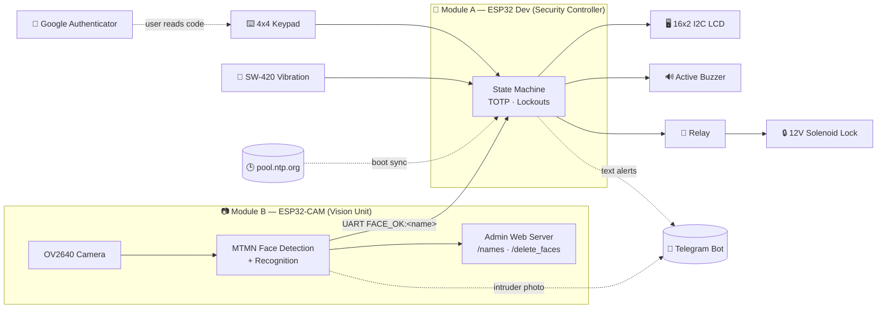
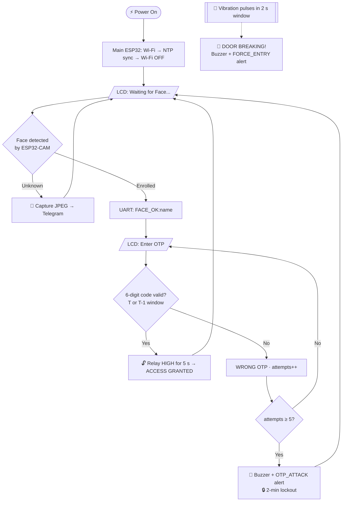

<div align="center">

# 🔐 Multi-Factor Authentication Based Door Lock System

**Face Recognition + TOTP + Vibration-Based Intrusion Detection on a dual-ESP32 platform**


*A low-cost, real-time smart access control system that opens the door only when **who you are** (your face) and **what you have** (a Google Authenticator code) both check out — and tells you on Telegram the moment someone tries to break in.*

[Features](#-features) •
[Architecture](#-system-architecture) •
[How It Works](#-how-it-works) •
[Hardware](#-hardware) •
[Wiring](#-pin-configuration) •
[Setup](#-getting-started) •
[Results](#-results) •
[Team](#-team)

</div>

---

## 📖 Overview

Conventional locks — keys, keypads, even single-factor biometric locks — are vulnerable to duplication, password leakage, photo spoofing, and brute force. This project layers **three independent defences** into a single embedded system:

| Layer | Mechanism | Defends against |
|:---:|---|---|
| 🧑 **Factor 1** | On-device face recognition (MTMN CNN) on the **ESP32-CAM** | Strangers, lost/duplicated keys |
| 🔢 **Factor 2** | 6-digit **TOTP** from Google Authenticator, verified on the **ESP32** | Face spoofing (photos/videos), shoulder-surfing |
| 📳 **Watchdog** | **SW-420** vibration sensor with temporal pulse-windowing | Physical forced entry / door breaking |

Every suspicious event — unknown face, OTP brute force, master-PIN attack, or door breaking — triggers a **local buzzer** and a **Telegram alert**, with a **photo of the intruder** where applicable.

> 📄 Developed as the B.Tech final-year project, Department of ECE, **Sri Venkateswara University College of Engineering, Tirupati** (2025–26).

---

## ✨ Features

- 🧠 **Edge-AI face recognition** — MTMN detection + feature-vector matching runs entirely on the ESP32-CAM's PSRAM. No cloud, no Raspberry Pi.
- ⏱️ **SIM-free TOTP (RFC 6238)** — HMAC-SHA1 codes from Google Authenticator. No SMS costs, no delivery delays.
- 🕰️ **Clock-drift tolerance** — NTP sync at boot; accepts the current **and** previous 30-s window to absorb typing delay.
- 📸 **Intruder snapshots** — unrecognised faces are captured as JPEG and sent to Telegram via a multipart HTTPS POST.
- 📳 **Smart tamper detection** — 2-second pulse-accumulation window filters out wind and passing-vehicle noise.
- 🚫 **Brute-force lockouts** — 5 wrong OTPs or 3 wrong master PINs ⇒ 2-minute hard lockout + alarm + Telegram alert.
- 🔑 **Offline master PIN** — fallback access when Wi-Fi is down, still rate-limited.
- 🌐 **Admin web dashboard** — live stream, camera tuning, face enrolment, `/names` (ID → name in NVS) and `/delete_faces`.
- 📶 **Minimal attack surface** — the main controller turns its Wi-Fi radio **off** after time sync and wakes it only to send alerts.
- ⚡ **Hardware-safe actuation** — opto-isolated relay, 1N4007 flyback diode, 1000 µF bulk capacitor, single 12 V supply via LM2596.

---

## 🏗️ System Architecture

The workload is split across two microcontrollers so heavy vision processing never blocks real-time security logic.



<details>
<summary><b>🔌 View full circuit schematic</b></summary>
<br/>
<p align="center"></p>
</details>

---

## ⚙️ How It Works



### Phase by phase

| Phase | What happens |
|---|---|
| **Boot** | ESP32-CAM disables its brownout detector for stable camera init and starts its web server. Main ESP32 syncs UTC via NTP, then shuts Wi-Fi off. |
| **0 · Always-on monitoring** | First vibration pulse opens a 2-s window. Sustained pulses ⇒ `FORCE_ENTRY` event (10-s alert cooldown). |
| **1 · Biometrics** | ESP32-CAM detects, aligns and matches the face against enrolled IDs. Unknown ⇒ intruder photo to Telegram. Known ⇒ `FACE_OK:<name>` over UART. |
| **2 · TOTP** | User keys in the 6-digit code. ESP32 computes HMAC-SHA1 TOTP for the current and previous 30-s step and compares. |
| **3 · Actuation** | Success ⇒ relay energises the solenoid for 5 s, then relocks. Failure ⇒ counter, and lockout on threshold. |

### Security policies

| Event | Threshold | Response | Telegram alert |
|---|:---:|---|---|
| Unknown face | 1 | Capture & send photo | 📸 Intruder image |
| Wrong OTP | 5 | 2-min lockout + alarm | `OTP_ATTACK` |
| Wrong master PIN | 3 | 2-min lockout + alarm | `MASTER_PIN_ATTACK` |
| Forced entry | Pulses within 2 s | Alarm (20 beeps) | `FORCE_ENTRY` |

> During a lockout, **all** keypad input and face-recognition triggers are ignored.

---

## 🧰 Hardware

| # | Component | Key specs | Role |
|:-:|---|---|---|
| 1 | ESP32-CAM (AI Thinker) | 240 MHz dual-core, OV2640 2 MP, PSRAM | Face recognition, intruder photos |
| 2 | ESP32 Dev Module | 240 MHz dual-core, Wi-Fi/BT | Main security controller |
| 3 | FT232RL USB-to-TTL | 3.3 V / 5 V | Programming the ESP32-CAM |
| 4 | Solenoid door lock | 12 V DC, 1–2 A | Physical lock |
| 5 | 1-ch relay module | 5 V coil, 10 A contacts | Isolated lock switching |
| 6 | 1N4007 diode | 1000 V, 1 A | Flyback protection |
| 7 | 16x2 LCD + PCF8574 I2C backpack | Addr `0x27` | Status display |
| 8 | 4x4 matrix keypad | 16 keys | OTP / PIN entry |
| 9 | SW-420 vibration sensor | Digital out, adjustable | Tamper detection |
| 10 | Active piezo buzzer | 5 V, built-in oscillator | Local alarm |
| 11 | 12 V DC adapter | 2 A | Main supply |
| 12 | LM2596 buck converter | 12 V → 5 V, ~80–90 % eff. | Logic supply |
| 13 | Electrolytic capacitor | 1000 µF, 16 V | Brownout prevention |
| 14 | DC jack, zero PCB, headers, 22 AWG wire | — | Assembly |

### ⚡ Power tree

```
12V 2A Adapter ──┬──► Relay contacts ──► 12V Solenoid Lock  (1N4007 across coil)
                 │
                 └──► LM2596 (→5V) ──┬──► ESP32 Dev (5V pin)
                                     ├──► ESP32-CAM (5V)
                                     ├──► Relay module VCC
                                     ├──► Buzzer · LCD
                                     └──► 1000µF across 5V/GND
```

---

## 📌 Pin Configuration

**Main ESP32 (Dev Module)**

| Peripheral | ESP32 pin |
|---|---|
| ESP32-CAM UART → `RX2` / `TX2` | **GPIO 16** / **GPIO 17** (115200 baud) |
| LCD I2C `SDA` / `SCL` | GPIO 21 / GPIO 22 (default `Wire`) |
| Vibration sensor `DO` | **GPIO 34** |
| Relay `IN` | **GPIO 23** |
| Buzzer `+` | **GPIO 4** |
| Keypad rows R1–R4 | GPIO **13, 12, 14, 27** |
| Keypad cols C1–C4 | GPIO **26, 25, 33, 32** |

**ESP32-CAM → Main ESP32:** `U0T (TX)` → `GPIO 16 (RX2)`, common `GND`.

---

## 💻 Software Stack

| Tool / Library | Used for |
|---|---|
| Arduino IDE 1.8.x / 2.x + ESP32 board package | Build & flash both boards |
| `esp_camera`, `esp_http_server`, face recognition (`fd_forward` / `fr_forward`) | Camera, web server, MTMN |
| `Preferences` (NVS) | Persisting face ID → name mapping |
| `TOTP` | HMAC-SHA1 one-time passwords |
| `time.h` + NTP | UTC synchronisation |
| `WiFi`, `WiFiClientSecure`, `HTTPClient` | HTTPS calls to Telegram |
| `LiquidCrystal_I2C`, `Keypad` | UI |
| Google Authenticator (mobile) | Code generation for users |

---

## 📁 Repository Structure

```
mfa-door-lock/
├── firmware/
│   ├── esp32_cam/
│   │   └── CameraWebServer/
│   │       ├── CameraWebServer.ino   # Wi-Fi, camera init, FACE_OK over serial
│   │       ├── app_httpd.cpp         # Web server, face recognition, Telegram photo upload
│   │       └── camera_pins.h
│   └── esp32_main/
│       └── esp32_main.ino            # TOTP, keypad, LCD, relay, vibration, lockouts, alerts
├── docs/
│   ├── images/
│   └── FINAL_YEAR_PROJECT_REPORT.pdf
└── README.md
```

---

## 🚀 Getting Started

### 1. Prerequisites
- Arduino IDE with the **ESP32 board package** (Espressif). Use a core version that still ships the legacy face-recognition libraries used by the `CameraWebServer` example (1.0.x).
- Libraries: `LiquidCrystal_I2C`, `Keypad`, `TOTP` (Arduino TOTP library).
- A Telegram bot from [@BotFather](https://t.me/BotFather) and your chat ID.

### 2. Create your TOTP secret
1. Pick a random 10-byte secret and convert it to **Base32**.
2. Add it to Google Authenticator (*Enter a setup key → Time-based*).
3. Put the **same bytes** in `hmacKey[]` in `esp32_main.ino`.

### 3. Configure credentials

> ⚠️ **Never commit real credentials.** Keep them in a git-ignored `secrets.h`.

```cpp
// secrets.h  (add to .gitignore)
#define WIFI_SSID      "your-wifi"
#define WIFI_PASSWORD  "your-password"
#define BOT_TOKEN      "123456789:ABC-your-bot-token"
#define CHAT_ID        "your-chat-id"
#define MASTER_PIN     "choose-a-strong-pin"
static uint8_t hmacKey[] = { /* your 10-byte TOTP secret */ };
```

### 4. Flash the ESP32-CAM
1. Wire FT232RL: `TX→U0R`, `RX→U0T`, `5V`, `GND`, and bridge **GPIO 0 → GND**.
2. Board: **AI Thinker ESP32-CAM**, Partition: **Huge APP**, PSRAM: **Enabled**.
3. Upload, remove the GPIO 0 jumper, press **RST**.
4. Open Serial Monitor (115200) and note the IP address.

### 5. Enrol faces
1. Browse to `http://<cam-ip>` → **Start Stream** → enable **Face Recognition** → **Enroll Face**.
2. Go to `http://<cam-ip>/names` to assign a name to each Face ID.
3. Use `http://<cam-ip>/delete_faces` to wipe all enrolments.

### 6. Flash the main ESP32
Board: **ESP32 Dev Module**. Upload `esp32_main.ino`, wire the UART link, and power everything from the 12 V supply.

---

## 📊 Results

<table>
<tr>
<td align="center"><br/><sub><b>Boot:</b> NTP time sync</sub></td>
<td align="center"><br/><sub><b>Idle:</b> waiting for face</sub></td>
</tr>
<tr>
<td align="center"><br/><sub><b>Factor 1 passed:</b> greeting + OTP prompt</sub></td>
<td align="center"><br/><sub><b>Factor 2 passed:</b> lock released</sub></td>
</tr>
<tr>
<td align="center"><br/><sub><b>Wrong OTP</b> attempt tracked</sub></td>
<td align="center"><br/><sub><b>Brute force:</b> 120-s lockout</sub></td>
</tr>
<tr>
<td align="center" colspan="2"><br/><sub><b>Simulated forced entry</b> detected → alarm + Telegram</sub></td>
</tr>
</table>

### Admin web interface (ESP32-CAM)

<p align="center">
&nbsp;&nbsp;
&nbsp;&nbsp;

</p>
<p align="center"><sub>Live stream & camera controls · Face Naming Manager (<code>/names</code>) · Flash wipe (<code>/delete_faces</code>)</sub></p>

### Key outcomes
- ✅ Working **two-factor authentication**: physical presence (face) **and** digital possession (TOTP).
- ✅ **Galvanic isolation** and voltage regulation protect the MCU from solenoid back-EMF.
- ✅ **Real-time Telegram alerts** for OTP attacks, master-PIN attacks, unknown faces and forced entry.
- ✅ **Low-cost, scalable** build from commodity IoT parts.

---

## 🆚 Compared with Related Work

| Approach | Limitation | This project |
|---|---|---|
| Face-only IoT lock | Spoofable with photos; lighting-sensitive | TOTP second factor blocks spoofed faces |
| Raspberry Pi + servo lock | Heavy OS, weak servo mechanism | Bare-metal ESP32, solenoid via isolated relay |
| Deep CNN face recognition | Too heavy for MCUs | Lightweight MTMN + TOTP compensates |
| Face + SMS OTP | SIM/SMS cost, delivery delays | Offline TOTP via Google Authenticator, no SIM |

---

## ⚠️ Limitations & 🔮 Future Work

| Current limitation | Possible enhancement |
|---|---|
| Recognition sensitive to lighting and camera angle | IR illumination, liveness / anti-spoofing checks |
| Alerts need Wi-Fi | GSM/LoRa fallback for alerts |
| Pre-enrolled users only | Cloud / app-based user management |
| No power backup | Li-ion UPS with fail-secure lock policy |
| Telegram TLS uses `setInsecure()` | Pin Telegram's root CA certificate |
| Brownout detector disabled on the CAM | Better supply decoupling so BOD can stay enabled |

---

## 👥 Team

| Name | Roll No. |
|---|---|
| **Sama Vineel** | 12204055 |
| **Chemuduru Keerthana** | 12204013 |
| **Amballa Mohana Venkata Keerthana** | 12204002 |

**Guide:** Dr. G. Umamaheshwara Reddy, Professor, Dept. of ECE
**Head of Department:** Dr. I. Kullayamma
**Institution:** Sri Venkateswara University College of Engineering, Tirupati – 517502

---

## 📚 References

1. Espressif Systems — *ESP32 Series Datasheet* & *ESP32-CAM Technical Reference*
2. D. M'Raihi et al., *TOTP: Time-Based One-Time Password Algorithm*, **RFC 6238**, 2011
3. [Google Authenticator](https://github.com/google/google-authenticator)
4. [Telegram Bot API](https://core.telegram.org/bots/api)
5. Texas Instruments — *LM2596 Buck Converter Datasheet*; NXP — *PCF8574 Datasheet*; Hitachi — *HD44780 Datasheet*
6. Rajkamal, *Embedded Systems: Architecture, Programming and Design*, 3rd ed., McGraw-Hill, 2017
7. A. Bahga & V. Madisetti, *Internet of Things: A Hands-On Approach*, Universities Press, 2015

Full reference list is in the [project report](docs/FINAL_YEAR_PROJECT_REPORT.pdf).

---

## 📄 License

Original code in this repository is released under the **MIT License**.
`app_httpd.cpp` is derived from Espressif's `CameraWebServer` example and remains under the **Apache License 2.0**.

<div align="center">

⭐ **If this project helped you, consider giving it a star!** ⭐

</div>
